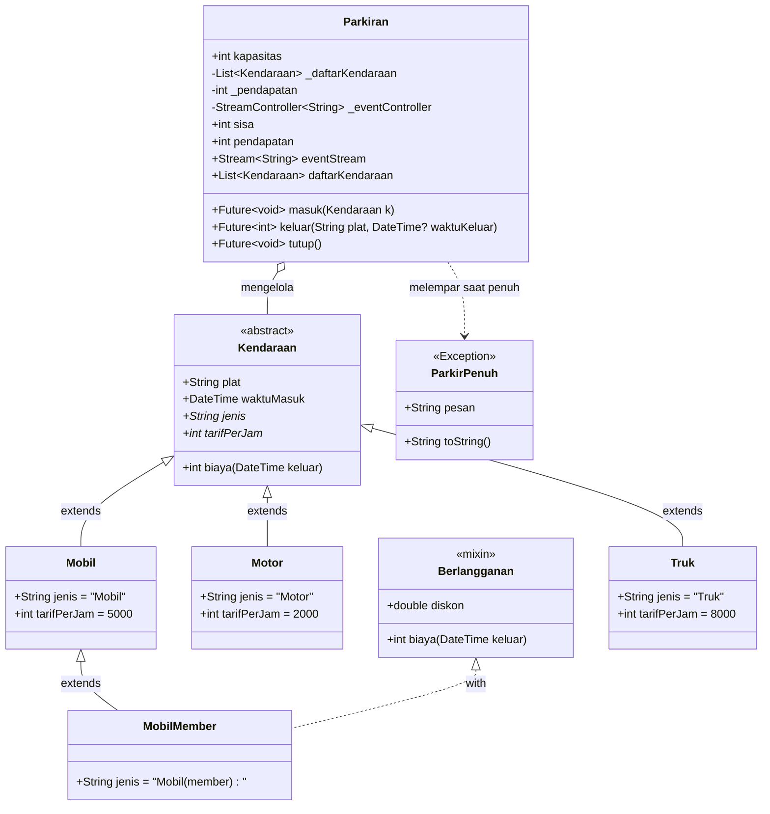
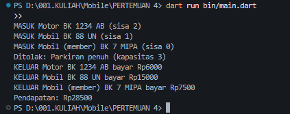
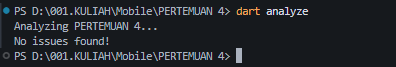

# Tugas Rutin 4: Sistem Parkir Kampus 
---

## A. Identitas Mahasiswa
- **Nama:** M. Gali Almhadi
- **NIM:** 4243250042
- **Kelas:** PSIK 24 D  2024
---

## B. Diagram Kelas (Class Diagram)

Berikut adalah struktur hierarki kelas dan relasi antar komponen dalam sistem parkir:

---

## C. Tangkapan Layar Keluaran Program (Output Console)

Hasil eksekusi program `bin/main.dart`:

Hasil Analyz :

---

## D. Penjelasan Penerapan Konsep

Pada program sistem parkir ini, ketiga konsep utama diterapkan secara terstruktur:

1. **Enkapsulasi (Encapsulation):**  
   Diterapkan pada kelas Parkiran dengan menyembunyikan data internal menggunakan awalan garis bawah (`_daftarKendaraan`, `_pendapatan`, dan `_eventController`). Akses terhadap data ini dikendalikan melalui *getter* publik seperti `sisa`, `pendapatan`, dan `daftarKendaraan` (menggunakan `List.unmodifiable`) sehingga mencegah modifikasi langsung yang tidak sah dari luar kelas.

2. **Polimorfisme (Polymorphism):**  
   Diterapkan melalui tipe dasar `Kendaraan` yang menaungi berbagai turunan spesifik (`Motor`, `Mobil`, `Truk`, dan `MobilMember`). Koleksi kendaraan disimpan dalam satu `List<Kendaraan>`. Ketika method `biaya(DateTime keluar)` dipanggil, Dart mengeksekusi implementasi sesuai objek konkretnya, termasuk `MobilMember` yang menerapkan mixin `Berlangganan` untuk memotong biaya sebesar 50%.

3. **Pemrograman Asinkron (Async Programming):**  
   Diterapkan pada method `masuk()` dan `keluar()` yang menggunakan kata kunci `async`, `await`, dan `Future<void>.delayed` guna mensimulasikan waktu buka/tutup palang otomatis secara non-blocking. Selain itu, notifikasi pos jaga dipancarkan secara *real-time* memanfaatkan `StreamController<String>.broadcast()` yang dikonsumsi oleh listener event stream di `main()`.

---

## E. Pernyataan Penggunaan AI
asisten AI membantu perancangan diagram Mermaid, verifikasi static analysis (`dart analyze`), serta penyusunan dokumentasi tugas sesuai standar rubrik penilaian Modul Ajar Pemrograman Mobile. 
---
